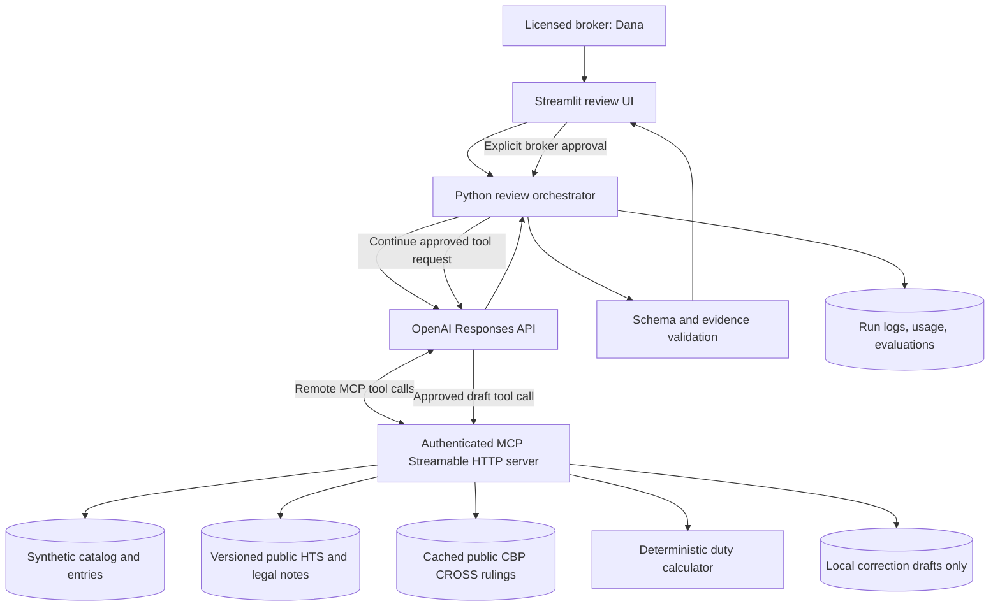

# ARCHITECTURE.md — Tariff Classification Review

**Status:** Authenticated Responses API + private MCP tunnel vertical slice validated end to end — v0.6  
**Last updated:** 2026-10-19
**Selected product surface:** OpenAI Platform and APIs  
**Companion documents:** `PROJECT.md` (product intent), `AGENTS.md` (Codex development instructions)

> This document translates the original *Tariff Classification Review — Build Plan* into a greenfield implementation design. It is a working proposal, not evidence that APIs, tariff codes, rulings, or workflows have been tested. Codex must verify current OpenAI API details using the configured OpenAI Developer Documentation MCP server before implementation. Significant design changes require review.

### OpenAI documentation validation record

Validated on 2026-10-19 using the configured OpenAI Developer Documentation MCP server and the current Responses API OpenAPI description. This is a documentation-level validation, not a live API or MCP interoperability test.

| Area | Result | Required architecture treatment |
|---|---|---|
| Remote MCP transport | Compatible with the proposal | Use `server_url` for a public remote MCP server over Streamable HTTP or HTTP/SSE, or `tunnel_id` for a private/local server through Secure MCP Tunnel. The official MCP Python SDK v2 server has passed local Streamable HTTP protocol checks. |
| Remote MCP authentication | Gap corrected below | For an authenticated remote server, the application obtains and refreshes an OAuth access token separately and supplies it server-side in the MCP tool's `authorization` field. Never expose or log it in the browser. |
| Tool restriction | Compatible, now explicit | Set `allowed_tools` to the exact tools needed for the workflow. Do not rely only on tool descriptions or prompt instructions. |
| MCP discovery reuse | Compatible with bounded reuse | Preserve an error-free `mcp_list_tools` item in context to avoid relisting. Reuse only for the same server and exact tool policy; do not carry prior business data or reuse discovery across review and draft permission boundaries. |
| MCP approvals | Gap corrected below | Approval requests appear as `mcp_approval_request` output items. Each approval covers one call and is continued with `previous_response_id` plus an `mcp_approval_response`, or by manually carrying response output into the next request. |
| Structured outputs | Gap corrected below | Use `text.format` with JSON Schema and `strict: true`; the root must be an object, all fields must be required, nullable unions represent optional values, and every object must set `additionalProperties: false`. Handle refusals and incomplete responses before parsing. |
| Model compatibility | Still requires a preflight | The selected model must support both remote MCP and Structured Outputs. Keep the model configurable and verify the combination with one live smoke test before feature work. |

Primary sources: [MCP servers](https://developers.openai.com/api/docs/guides/tools-connectors-mcp), [MCP approval flow](https://developers.openai.com/api/docs/guides/tools-connectors-mcp#approvals), [Structured Outputs](https://developers.openai.com/api/docs/guides/structured-outputs), and [supported JSON schemas](https://developers.openai.com/api/docs/guides/structured-outputs#supported-schemas).

## 1. Architecture objective

Enable Harbor & Crane to deliver a premium, evidence-backed tariff classification audit to Northfield Home Goods. The application identifies **potential base-duty overpayments** as the importer-facing aha moment and provides a repeatable, lower-cost workflow that could support **new audit-service revenue** for the brokerage. Trust comes from source-backed reasoning, independently computed dollars, explicit uncertainty, and licensed-broker control.

**Primary path:** select importer and SKUs → retrieve product/entry data → evaluate classification against HTS legal text and relevant CBP rulings → calculate duty difference → display prioritized findings → broker approves a *draft* correction (no filing).

**Out of scope:** automated CBP filings, refund-eligibility determinations, actual recoverable-refund guarantees, full tariff overlay calculations, production multi-tenant deployment, or replacing licensed broker judgment.

## 2. High-level system diagram



**Trust boundary:** model output is a proposal, not an authoritative rate, final legal determination, or filing instruction. Data and MCP tool outputs are untrusted content; the application validates outputs and enforces write authorization.

## 3. Component responsibilities

| Component | Initial choice | Responsibility | Must not do |
|---|---|---|---|
| Review UI | Streamlit, Python | Client/SKU selection, editable description, progress, findings, evidence, approval, cost | Represent draft as filed or dollar difference as guaranteed refund |
| Orchestrator | Python module (`agent/client.py`) | Create/continue Responses API requests, handle approval pauses, collect usage, validate results, persist runs | Invent source facts or silently ignore failed calls |
| Model interaction | Responses API, official Python SDK | Reason over descriptions, tariff text, notes, and rulings; choose tool calls; propose structured findings | Supply duty rates or financial totals from memory |
| Tool interface | Official MCP Python SDK over Streamable HTTP | Expose narrowly scoped business, source, calculator, and draft tools | Expose arbitrary file access or unauthenticated writes |
| Source cache | Local versioned JSON/text | Preserve HTS provisions, legal notes, CBP ruling text, source URLs, dates, revision | Claim cache is live or comprehensive |
| Duty engine | Pure Python (`data/duty.py`) | Look up validated base rates and price synthetic historical entries | Accept model-provided rate values |
| Approval/draft store | JSONL or local file | Persist approved correction *drafts* with evidence and audit metadata | Submit to CBP or change historical entries |
| Evaluations | Python runner and deterministic graders | Test held-out classification cases, scenario behavior, math, citations, safe failures | Expose held-out answers to agent search |

## 4. Data contracts and provenance

### 4.1 Product and entry data

Synthetic catalog: `client_id`, `sku_id`, supplier description, declared HTS code, material/composition, use, dimensions and other known attributes. Missing attributes remain genuinely missing. Synthetic entries: entry identifier, date, SKU, entered value, quantity, declared code, and duty paid under the scoped rate assumptions.

Use a seeded generator so reviewers can reproduce all values. Keep the generator's **answer key inaccessible to the agent**; it is only for fixture validation and evaluation.

### 4.2 Public legal data

Cache only the USITC HTS tariff lines, Column 1 General base rates, and section/chapter notes required by 2–3 verified scenarios, with original URL and effective schedule revision/date. Target 6–10 CBP CROSS rulings, with four as the acceptable minimum if research is slow. Cache each ruling's ID, date, product facts, classification, relevant reasoning, and source URL. Preserve exact code granularity; an HTS 8-digit rate line and a 10-digit reporting number serve different purposes.

Rulings are evidence for analogous cases, not automatic proof for every SKU. An agent may cite only a ruling actually fetched during that run. If an essential legal note, tariff line, or product attribute is missing, report an incomplete or needs-information outcome rather than inventing it.

### 4.3 Duty calculation contract

For each historical entry, use the applicable **validated rate and effective date** for the declared and proposed classifications, or explicitly mark historical repricing unsupported. For the initial prototype, restrict examples to rates and periods the cache can accurately represent; do not silently apply today's rate to past entries.

For a simple ad valorem base rate:

`base_duty = entered_value × validated_base_rate`

`potential_base_duty_difference = duty_at_declared_code − duty_at_proposed_code`

Positive = potential overpayment; negative = potential underpayment. Aggregate positive and negative amounts separately. Handle non-ad-valorem or compound rates by exclusion or a verified dedicated calculator, not by treating them as percentages.

The model proposes codes; the duty engine looks up rates and computes amounts. Unknown codes, missing effective-date rates, unsupported duty types, or inconsistent entries must return explicit errors.

**Financial caveat:** These are scoped *base-duty differences*, not confirmed refundable amounts. Section 301/232, IEEPA and other overlays, origin, entry status, deadlines, and legal recovery procedures are outside this initial calculation.

## 5. MCP tool surface (implemented)

The MCP server retains seven read tools (including legacy single-query helpers), one deterministic calculator, and one approval-gated draft tool. The model-facing review imports only four batch-aware evidence/data tools. The application invokes its local deterministic calculator after validating the model proposal; `compute_duty_delta` remains registered for direct MCP validation and server-side draft checks but is not available to the model during review. Chapter-note distinctions required by the three scenarios are held in the bounded evidence fixtures rather than a separate general-purpose notes tool.

| Tool | Inputs (illustrative) | Result |
|---|---|---|
| `get_catalog` | `client_id`, selected `sku_ids`, optional description overrides | All selected SKU descriptions and declared codes in one batch |
| `get_entries` | `client_id`, selected `sku_ids` | All selected entry records in one batch |
| `search_hts_batch` | several queries/code prefixes | Query-grouped candidate tariff lines, text, rates, source revision |
| `search_rulings_batch` | several ruling/product queries | Query-grouped full cached ruling facts, classification, reasoning, ruling ID, and URL |
| `compute_duty_delta` | client, SKU, declared/proposed code, dates | Validated rates, amounts, signed delta, scope, error status |
| `draft_correction` | client, SKU, codes, evidence IDs, rationale, route | **Draft only**, persisted after authorization |

All tools validate identifiers and arguments. Read tools return compact, bounded results. The small evidence index uses deterministic normalized token-overlap ranking so model-style natural-language queries can retrieve the same bounded verified records as exact code or ruling-ID queries; it does not add external or fuzzy evidence. Search only the allowed ruling index, never the held-out evaluation set. Expose only the minimum client data required for the requested review.

Configure the Responses API review MCP tool with `allowed_tools` set to the four model-facing tools. A remote endpoint specified by `server_url` must be reachable by OpenAI's servers and use Streamable HTTP or HTTP/SSE. If the service stays local or private, use Secure MCP Tunnel and `tunnel_id` instead of making the service public. The official MCP Python SDK v2 implementation has passed local in-memory and Streamable HTTP tool discovery and calculator calls. Gate 2 still requires OpenAI-hosted access through the selected authenticated remote transport.

For repeated reviews in one UI session, retain only an error-free `mcp_list_tools` item whose server label, transport, endpoint/tunnel ID, and four imported tool names exactly match the current review policy, and whose imported tools all contain input schemas. Reuse it for at most 30 minutes by including it with the new review input; this avoids relisting while keeping credentials, prior product data, tool outputs, and model conclusions out of the cache and the new run. Streamlit session state preserves this schema-only record across reruns and safe client recreation. Expired, incomplete, mismatched, or failed discovery is discarded. Draft requests use a different one-tool allowlist and never reuse review discovery. The approval continuation safely retains its own discovery through `previous_response_id`.

For an authenticated public remote MCP server, the web application—not the browser—owns OAuth client registration, access-token acquisition, refresh, expiry handling, and revocation. It supplies the current access token in the MCP tool's `authorization` field when creating or continuing a Response. Tokens stay in server-side secret storage, are never placed in model instructions or tool arguments, and are redacted from logs. The prototype must not deploy an unauthenticated public MCP endpoint. If the demo uses `tunnel_id`, document the tunnel's authentication and operator access separately.

Illustrative reviewed policy for a public remote demo server:

```json
{
  "type": "mcp",
  "server_label": "tariff_review",
  "server_description": "Read versioned tariff evidence for a bounded classification review.",
  "server_url": "https://example.invalid/mcp",
  "authorization": "<server-side OAuth access token>",
  "allowed_tools": [
    "get_catalog",
    "get_entries",
    "search_hts_batch",
    "search_rulings_batch"
  ],
  "require_approval": {
    "never": {
      "tool_names": [
        "get_catalog",
        "get_entries",
        "search_hts_batch",
        "search_rulings_batch"
      ]
    }
  }
}
```

The correction-draft request uses a separate MCP definition with `allowed_tools: ["draft_correction"]` and `require_approval: "always"`. During initial integration, replace the review's scoped policy with `"always"`. For a private/local server, replace `server_url` with `tunnel_id` and validate the tunnel-specific authentication path. MCP read/write annotations should accurately describe each tool, but annotations do not replace the explicit allowlist, approval policy, or server-side authorization.

**Approval design:** Treat the Responses API MCP approval mechanism as one layer, not the only security boundary. Start development with the default approval behavior or `require_approval: "always"` so every MCP data disclosure is visible. After the synthetic read payloads and project-owned server have been reviewed, the demo may use a scoped policy that skips approval only for the named read tools. Do not set a server-wide `"never"` policy while `draft_correction` is available.

`draft_correction` always requires approval. When the API returns an `mcp_approval_request`, the orchestrator persists its response ID, approval-request ID, tool name, and arguments, then shows those exact arguments to Dana. Approval or denial creates a new Responses API call using the prior response ID and an `mcp_approval_response`. Each approval applies to one tool call; the orchestrator must loop safely if another approval request follows. If response storage is disabled, carry the prior output items manually instead of assuming `previous_response_id` is available under the chosen retention policy.

The MCP server must independently verify that the referenced review is in an approved state in application-owned storage and that the request is current and single-use. A model-produced flag, prompt statement, or MCP approval response alone is insufficient authorization. A denied, expired, duplicated, mismatched, or missing approval must not create a draft.

## 6. Review execution sequence

1. **Start:** Dana selects Northfield and a representative SKU subset; the UI creates a run ID and calls the orchestrator.
2. **Gather:** The model uses permitted MCP read tools to retrieve product facts, HTS provisions/notes, and analogous rulings.
3. **Assess:** It confirms a declared code, proposes a supported alternative, or abstains and identifies missing facts. Cite the deciding rule and fetched evidence.
4. **Price:** For every changed classification, the orchestrator invokes the deterministic duty calculator directly after validating the proposal. The calculator is not model-visible, and no model-authored rates or dollars are accepted.
5. **Validate:** Application checks schema, known codes, retrieved citation IDs, calculator provenance, consistency, and appropriate underpayment escalation. Reject or mark incomplete on material validation failures.
6. **Present:** Show prioritized findings, separate overpayment/underpayment totals, affected entries, evidence links, uncertainties, and measured API cost.
7. **Approve:** Dana inspects the exact pending tool name and arguments and explicitly authorizes or denies that single correction draft. Continue the Responses flow with an `mcp_approval_response` associated with the returned approval-request ID and previous response, while the MCP server separately checks application-owned approval state. Never file with CBP.
8. **Record:** Save run trace, tool outcomes, model usage, validation results, and approval decision; redact secrets.

### Exact-rerun result cache

The Streamlit demo keeps a bounded, session-only cache of complete validated live
reviews for 30 minutes. Its fingerprint covers the selected SKU order, exact
description overrides, model and service tier, prompt and structured-output schema,
MCP server identity and four-tool allowlist, OpenAI SDK version, calculator and
orchestration code, and the product, entry, HTS, and ruling source files. Credentials
are excluded. Any material change therefore forces a live run.

Only records that passed structured-output, MCP-call, citation, HTS, SKU-coverage,
and deterministic-calculation validation are eligible. Failures, pending approvals,
and correction drafts are never cached. Cache hits are labeled in the UI, retain the
original response ID and measured execution metadata, and report that the reuse made
zero incremental OpenAI requests, MCP calls, or API cost. Dana can explicitly bypass
the cache with **Run fresh review**. The cache is an application optimization, not an
OpenAI prompt cache, and it is cleared when the Streamlit session ends.

**Live edit:** Dana changes a product attribute (e.g., stoneware to porcelain), reruns **that SKU**, and sees a changed or unchanged classification *based on verified HTS distinctions*. The system must not be forced to change its answer merely because the demo expects it.

## 7. Structured output

Use two contracts rather than treating model output as the entire application record.

### 7.1 Model-authored `ClassificationProposal`

Request Structured Outputs through the Responses API using `text.format` with a named JSON Schema and `strict: true`. The schema must follow the supported subset:

- the root is an object, not a top-level `anyOf`;
- every declared field is included in `required`;
- optional values use a union with `null` rather than an omitted field;
- every object, including nested objects, sets `additionalProperties: false`; and
- unsupported JSON Schema keywords are not used.

Implemented compact model fields:

- `run_id`, `client_id`, `status` (`complete` / `incomplete`)
- `findings[]`: `sku_id`, `proposed_code` (nullable), `outcome` (`potential_overpayment`, `potential_underpayment`, `needs_info`, `confirmed`), concise `deciding_rule`, `legal_notes_cited[]`, `rulings_cited[]`, `route_to` (`broker`, `counsel`, `supplier`), and nullable `missing_fact`

Declared codes, scope, tariff revision, standard warnings, recommended actions, and generic
broker-verification language are application-owned rather than repeated in model
output. Declared codes are hydrated from the validated `get_catalog` result and
checked against the application record. Missing information is represented once
on its finding. The client also
requires one complete batched `get_catalog` call and one complete batched
`get_entries` call for every review.

The model contract deliberately excludes duty rates, duty amounts, aggregate totals, API cost, validation errors, and approval state. Those fields are owned by deterministic application code.

Before parsing the proposal, require a completed response and explicitly handle refusal content, `incomplete` status, API errors, and failed `mcp_call` items. Structured Outputs guarantees schema adherence for a successful compatible response; it does not turn a refusal or truncated response into a valid business recommendation. The application must still apply domain and provenance validation after parsing.

### 7.2 Application-authored `ClassificationReview`

After validating the proposal's codes and evidence IDs, the application composes the review record with:

- the validated `ClassificationProposal`;
- MCP trace and source provenance;
- calculator-owned rate records, signed per-entry deltas, and separate overpayment/underpayment totals;
- response ID, model identifier, usage, elapsed time, and measured cost metadata;
- validation errors and safe failure state; and
- reviewer decision and approval audit data.

The UI renders only calculator-owned financial values. Confidence is explanatory, not a calibrated legal probability unless separately evaluated.

## 8. Security, governance, and failure handling

- **Authentication:** For a public remote MCP server, pass a separately acquired OAuth access token through the server-side Responses API `authorization` field. For a private/local server, use Secure MCP Tunnel with `tunnel_id`. Verify the chosen path end to end; do not expose an unauthenticated public endpoint.
- **Secrets:** `.env` is ignored by Git; commit `.env.example` only. Do not log authorization headers, tokens, or full secrets.
- **Prompt injection:** Treat supplier descriptions, HTS content, and ruling text as untrusted; ignore instructions embedded in them. Test a malicious supplier description.
- **Tool authorization:** Configure `allowed_tools`; use per-tool approval policy; require single-call broker approval plus independent server-side checks for writes; no external filings.
- **Underpayment:** Always surface and route potential underpayment to compliance/legal review; never net it silently against overpayments.
- **Missing data:** Return `needs_info` or `incomplete` with the failed dependency, not an invented answer.
- **Cost/latency:** Bound model turns, retrieved text size, per-run SKU count, retries, and timeouts. Report measured usage/cost with dated pricing assumptions.
- **Audit:** Log source IDs, tool results or safe summaries, calculations, approval decisions, and model/version identifiers. Keep synthetic-only demo data.
- **Recovery:** Preserve a tested sample run and screenshots as a presentation fallback if the live service is slow or unavailable.

## 9. Evaluation plan

Two focused layers:

**Independent public ruling checks (time permitting):** Keep at least one example outside the searchable corpus when the evidence count permits a meaningful split. Compare proposed classifications with the official ruling code at 6-digit and relevant 8-digit granularity. State the small sample size and limitations; do not present it as broad accuracy evidence.

**Synthetic workflow scenarios:** Evaluate overpayment detection, underpayment routing, correct-code decoy, missing attributes, edited description, prompt injection, missing entry data, approval gating, citation validity, and calculator consistency. Use deterministic graders where possible; repeat stochastic scenarios if time allows. Record pass/fail and actual cost/latency. Never manufacture evaluation outcomes.

Minimum invariants:

1. No fabricated or unfetched ruling citations.
2. No model-supplied tariff rate or monetary amount accepted as authoritative.
3. No correction draft without explicit authorized approval.
4. No hidden underpayment exposure.
5. No held-out answer leakage.
6. No silent success on tool or source failure.

## 10. UI and five-minute demo

A simple broker workbench, not a generic chatbot:

- **Selection:** importer, SKU subset, editable product description, Review action.
- **Evidence trail:** concise tool activity and sources, with optional expansion.
- **Findings:** prioritized potential base-duty overpayments; separate underpayments and needs-information cases; per-SKU source links and duty delta.
- **Approval:** evidence-first draft review with Approve/Reject; draft ID only after approval.
- **Progress visibility:** narrate review tools plus the approval-token, Responses API, `mcp_approval_request`, `mcp_approval_response`, and `draft_correction` stages, with heartbeats during quiet network periods and auto-follow of the newest active status message.
- **Measured execution:** API usage/cost and run duration visibly separated from importer duty amounts.

Planned demo beats: customer opportunity → review → evidence-backed financial finding → compliance/approval → live attribute edit → business impact and pilot. Optimize for a reliable five-minute walkthrough; pre-run a representative subset and keep a fallback trace.

## 11. Proposed repository layout

```text
tariff-review/
├── AGENTS.md
├── PROJECT.md
├── ARCHITECTURE.md
├── README.md
├── requirements.txt
├── .env.example
├── .gitignore
├── sources/
│   ├── hts/
│   ├── rulings_index/
│   └── rulings_heldout/       # optional when corpus size permits
├── config/answer_key.yaml
├── data/
│   ├── duty.py
│   ├── generate.py
│   ├── verify.py
│   └── generated/
├── server/mcp_server.py
├── agent/
│   ├── agent.py
│   ├── schema.py
│   └── instructions.md
├── app/ui.py
├── evals/
│   ├── run.py
│   ├── graders.py
│   ├── scenarios/
│   └── results.md
├── runs/
└── screenshots/
```

This layout is provisional; Codex may recommend a smaller structure, but must explain substantive deviations. Keep generated files and logs free of secrets.

## 12. Build sequence and acceptance gates

**Gate 1 — Evidence and fixtures (45 min):** Choose 2–3 verified scenarios with meaningful base-rate differences; verify 6–10 CROSS rulings (four minimum); create 12 synthetic SKUs and entries; deterministic fixture checks pass. Do not seed unsupported legal claims just to produce a large dollar figure.

**Gate 2 — Tools and calculator (55 min):** MCP reads work with authentication; duty calculator passes unit tests; invalid codes/dates fail explicitly; draft tool refuses unauthorized requests.

**Gate 3 — Responses workflow (60 min):** Responses API produces validated findings for one SKU, with real retrieved evidence and deterministic duty delta; full trace and measured usage are recorded.

**Gate 4 — UI and approval (45 min):** Streamlit presents the four required outcomes; broker approval controls drafts; edit-and-rerun responds to product facts.

**Gate 5 — Evaluation and hardening (45 min):** Focused scenario, citation, arithmetic, approval, injection, and failure checks run; actual correctness, latency, usage, and cost are recorded.

**Gate 6 — Presentation (50 min):** Three to five slides, concise documentation, a recorded fallback, and a rehearsed five-minute presentation are ready.

Do not begin stretch work until the core demo passes. Stretch candidates: full-catalog batch review, broader rulings, additional tariff overlays, and UI polish.

## 13. Architectural decisions and rationale

| Decision | Reason | Status |
|---|---|---|
| Responses API instead of Agents SDK | Single-agent workflow with explicit control of tool calls, approvals, and usage | Implemented and live-validated with GPT-6.1 Sol |
| MCP rather than only local functions | Demonstrates a reusable interface to brokerage data, legal evidence, and deterministic tools | Implemented and live-validated through an authenticated Secure MCP Tunnel |
| Streamlit + Python | Rapid implementation of a broker-facing workbench | Implemented and launch-tested |
| Cached, versioned legal sources | Reproducible citations and evaluation; avoids fragile live scraping | Implemented for 9 rulings and 6 rate lines |
| Deterministic rate calculation | Reproducible financial figures and clear trust boundary | Implemented and unit-tested |
| Broker-approved drafts only | Keeps consequential compliance decisions with authorized humans | Implemented with expiring single-use tokens |
| Base-duty-only initial scope | Defensible, bounded financial calculation | Implemented |
| Held-out ruling evaluation | Measures generalization rather than memorized lookup | Separate two-tool runner implemented; clean `gpt-6.1-sol` run measured 17/20 exact and 40/40 successful MCP calls; repeated model bake-off and licensed-broker review pending |
| Premium-audit business model | Links the workflow to incremental brokerage revenue | Implemented with clearly illustrative economics |

## 14. Remaining questions before the live demo

1. **Production identity:** Separate long-lived tunnel and application credentials, define rotation, and scope each identity to least privilege.
2. **Independent evaluation:** Repeat the 20-case held-out set across candidate models, run multiple samples, and obtain licensed-broker review before making classification-accuracy or generalization claims. The first single-run `gpt-6.1-sol` result is technical evidence, not a production accuracy estimate.
3. **Production recovery:** Define reconciliation for an API/network failure after a write tool may have executed; the prototype's single-use local token prevents duplicate drafts.
4. **Broader duty scope:** Chapter 99 duties, trade remedies, origin, preferences, deadlines, and legal recoverability remain intentionally excluded.

## 15. References for implementation

- OpenAI Developer Documentation MCP: `https://developers.openai.com/mcp` (configured in Codex as `openaiDeveloperDocs`).
- OpenAI Docs: [MCP servers](https://developers.openai.com/api/docs/guides/tools-connectors-mcp), including authentication, tool filtering, approvals, and safety.
- OpenAI Docs: [Structured Outputs](https://developers.openai.com/api/docs/guides/structured-outputs), including strict-schema requirements and refusal/incomplete handling.
- Original working source: *Tariff Classification Review — Build Plan*, 18 pages, supplied by project owner.
- Product direction: `PROJECT.md` v0.4.
- Official USITC HTS and CBP CROSS source URLs are recorded in `PHASE1_EVIDENCE.md` and `data/source_data/`.

**Implementation record:** OpenAI documentation validation, authenticated tunnel readiness, live response metadata, approval continuation, measured failures, evaluation results, and rehearsal timing are recorded in `LIVE_VALIDATION.md` and `TODO.md`.
